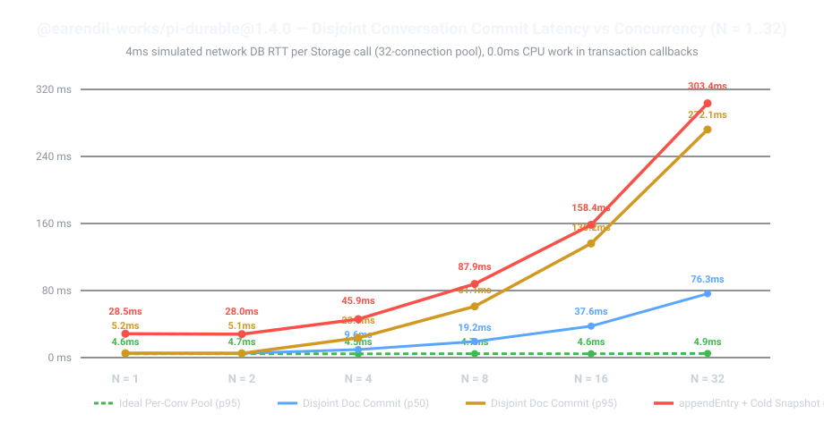

# `@earendil-works/pi-durable@1.4.0` — Disjoint Conversation I/O Serialization Repro (`N = 1..32`)

Minimal, 1-file standalone benchmark reproducing `SessionImpl.#tail` I/O queueing across **100% disjoint `ConversationId` scopes** over a networked `Storage` backend (`4ms` simulated DB RTT per Storage call, representing a 32-connection same-region Postgres/CockroachDB pool).

Every transaction callback in this benchmark performs **zero CPU work and zero external awaits** (only `d.rev += 1` and `tx.appendEntry`).



## Run

```bash
npm install
npm start
```

## Measured Results (`@earendil-works/pi-durable@1.4.0`, `DB_RTT_MS = 4ms`)

| Concurrent Disjoint Conversations (`N`) | Ideal Per-Conv Pool (`p95`) | `pi-durable` Disjoint `ConversationDoc` (`p50`) | `pi-durable` Disjoint `ConversationDoc` (`p95`) | `pi-durable` Disjoint `ConversationDoc` Wall Time | `pi-durable` Disjoint `appendEntry` + `doc` + 2 Cold `snapshot()` Reads (`p95`) |
| --- | --- | --- | --- | --- | --- |
| **`N = 1`** | `4.6 ms` | `5.2 ms` | `5.2 ms` | `5.3 ms` | `28.5 ms` |
| **`N = 2`** | `4.7 ms` | `5.1 ms` | `5.1 ms` | `19.2 ms` | `28.0 ms` |
| **`N = 4`** | `4.5 ms` | `9.6 ms` | `23.6 ms` | `37.6 ms` | `45.9 ms` |
| **`N = 8`** | `4.7 ms` | `19.2 ms` | `61.1 ms` | `75.1 ms` | `87.9 ms` |
| **`N = 16`** | `4.6 ms` | `37.6 ms` | `136.2 ms` | `150.6 ms` | `158.4 ms` |
| **`N = 32`** | `4.9 ms` | `76.3 ms` | **`272.1 ms`** | **`300.4 ms`** | **`303.4 ms`** |

## Root Causes in `@earendil-works/pi-durable@1.4.0`

1. **Global `SessionImpl.#tail` FIFO Serialization Across Disjoint Conversations (`dist/session/session.js:34-66, 150-195`)**:
   - `SessionImpl.commitWith()` chains every transaction onto one process-wide promise (`this.#tail`).
   - When `N = 32` concurrent workers commit to 32 completely distinct `conversationId`s over a 32-connection DB pool (`4ms` per `storage.commit`), they execute serially instead of concurrently (`p95 = 272.1ms` vs `4.9ms`).
2. **Cold `SessionImpl.snapshot()` Enqueues onto the Mutation Line (`dist/session/session.js:186-191`)**:
   - When a `ConversationDoc` is not currently in `this.#documents`, `snapshot()` runs `this.#enqueue(() => this.#loadDocument(...))` on `this.#tail` (which does two sequential `Storage` reads: `findDocument` + `document`), blocking commits on all other conversations while waiting on cold read I/O.
3. **`Transaction.#appendEntry` Sequential Storage Reads Inside `#tail` (`dist/session/transaction.js:139-151`)**:
   - `#appendEntry` awaits `this.#requireConversation(conversationId)` (`storage.conversation(id)`) inside the global `#tail` lock before staging the entry write, adding another `Storage` RTT to every turn entry commit.
